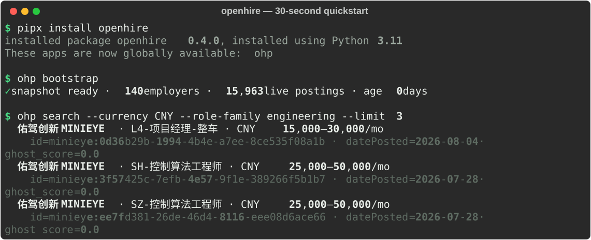

<!-- mcp-name: io.github.gzchenhao/openhire -->

# OpenHire · 开聘

> **A job-search radar for your AI assistant — first-party listings, every posting's real age, and your résumé never touches our servers.**
> 让 AI 助手替你盯岗的求职雷达：一手职位、岗位在架时长打分，简历不经过我们的服务器。

     [](https://glama.ai/mcp/servers/gzchenhao/openhire)

<p align="center"></p>
<p align="center"><sub>Real terminal output — install from PyPI, download the public index, search. No account, no signup.</sub></p>

> **Every number here is checkable.** [Open-duration report](https://gzchenhao.github.io/openhire/report/)
> (per-employer medians, named, monthly) · [numbers.json](https://gzchenhao.github.io/openhire/numbers.json)
> (the provenance of every figure we quote, regenerated each refresh) ·
> [raw report data](https://gzchenhao.github.io/openhire/report-data.json).
> 我们引用的每个数字都能核：[岗位在架时长月报](https://gzchenhao.github.io/openhire/report/) ·
> [numbers.json](https://gzchenhao.github.io/openhire/numbers.json)

> **Is your company in here, and you did not put it here?**
> Your postings are in this index because your own careers page serves them publicly. We
> can measure how long a role has been open; we cannot see why, and a long-open role is a
> question, not a verdict. [Claim your company](#for-employers-claim-your-tenant) — free,
> no payment, ever — and say why in your own words, or ask us to remove you and we will,
> without arguing.
> 贵公司被收录了、而且不是贵公司提交的？[点这里认领](#for-employers-claim-your-tenant)，免费，
> 可以用自己的话解释，也可以直接要求我们移除。

## 三不原则 · Three things OpenHire never does

1. **不存简历 · No résumé, ever.** 简历留在你的电脑上。过网的只有一个你自己生成的匿名指纹和岗位号；协议里没有简历字段，多传一个 `resume` 参数会被拒绝，CI 测试钉死。
   Your résumé stays on your machine. Only an anonymous, client-generated fingerprint and a job id ever cross the wire; the protocol has no résumé field, an extra `resume` argument is refused, and CI pins it.
2. **不刷假单 · Never applies for you.** 它只把你送到雇主自己的投递页，从不向任何 ATS 提交申请；连表单长什么样，我们的测试也只用一次普通 GET 看，到此为止。
   It hands you the employer's own apply page and never submits anything to any ATS. Even our own tests only GET the form once and stop.
3. **不追踪 · No tracking.** 不埋点、不统计谁看了什么。服务器只记一条匿名授权（指纹 + 岗位号），没有你是谁；索引本身跑在你自己的机器上。
   No analytics, no view counting, no telemetry. The server keeps one anonymous authorization record (fingerprint + job id) and nothing about who you are; the index itself runs on your machine.

还有一条不在这三条里，但同样锁死：**排序买不到**，它是（匹配度，新鲜度）的纯函数，见下文三条隐私红线。
One more that is locked the same way: ranking cannot be bought; it is a pure function of (match, freshness). See the three red lines below.

### What your agent actually sees

You ask your assistant a question in plain language. It calls `search_jobs`, and every row comes
back carrying the employer's **real** posting date — so the agent can reason about staleness
instead of guessing.

> **You:** *Any senior Python roles that are actually still open? Skip the stale ones.*

```jsonc
// one row from search_jobs — trimmed to the fields that matter here
{
  "title":        "Senior Python Engineer",
  "company":      "MongoDB",
  "datePosted":   "2026-03-31",   // from the employer's ATS, not a board's refreshed label
  "days_open":    166,
  "ghost_score":  0.61,           // pure f(relist_count, datePosted) — frozen by a test
  "apply_channel":"https://boards.greenhouse.io/…",   // straight to the employer
  "verified_at":  "2026-09-02T09:47:10Z"
}
```

> **Assistant:** *This one has been open 166 days with a ghost_score of 0.61 — I'd deprioritise it.
> Here are four posted in the last three weeks instead…*

`ghost_score` measures **how long a posting has been open**, not whether the employer still intends
to hire. A long-open role can equally mean "hard to fill". Treat it as a reason to ask, not a verdict.

---

An MCP server that turns **any** MCP-speaking assistant — Claude, 豆包 Doubao, DeepSeek (through
an MCP client such as Cherry Studio or Chatbox), Cursor, 腾讯 WorkBuddy, TRAE, Windsurf, Cline,
ChatGPT (through the hosted endpoint below) — into a private radar for
**AI / Infra, autonomous-driving and embodied-AI jobs** — pulled straight from **172 employers'**
own career sites and public ATS APIs (Greenhouse / Lever / Ashby / 北森 Beisen / Moka, plus
first-party employer career sites such as Li Auto's), across
the US, Europe **and China** (Waymo, Figure, Zoox — and Unitree, XPeng, UBTECH, Mech-Mind…).
**No account. No signup. No résumé upload. Ever.**

Three things a job board won't do for you:

- **Surfaces how long each role has really been open.** Every listing carries a `ghost_score` aged off the employer's
  **real** posting date where the employer's system reports one (otherwise the day this index first
  saw it, flagged `date_signal`): the "2 days ago" a board shows you can be 300 days old in the ATS.
- **Structural privacy, not a pinky-promise.** There is no résumé field in the protocol; a CI
  test fails the build if anyone adds one. Matching runs on your machine — only an anonymous
  fingerprint reaches the server.
- **Ranking you can't buy.** Order is a locked pure function of (match, freshness). No
  sponsored slots, no bidding — the signature is frozen by a test.

This is the 「哨兵 / Sentinel」 reference implementation — see
`design_handoff_openhire_v01/README.md` for the full protocol spec.

---

## Quickstart — under a minute

**Nothing to install, and no crawl to sit through.** Add this to your MCP client's config:

```json
{ "mcpServers": { "openhire": { "command": "uvx", "args": ["openhire@latest", "serve"] } } }
```

Then ask your assistant for a job. That is the whole setup. The server downloads the ~30 MB
public index by itself in the background on first start, so searches fill in within a couple
of minutes while you are already talking to it. No account, no signup, no résumé upload.

**Not sure which of these steps are yours?** The [connect guide](https://gzchenhao.github.io/openhire/connect.html)
(国内：[openhire-vlny.onrender.com/connect](https://openhire-vlny.onrender.com/connect)) asks which assistant you
use (ChatGPT, Claude, 豆包, DeepSeek, Cursor, 腾讯 WorkBuddy, VS Code) and shows only that one's steps, with the
one block to paste. 选你用的助手，只看那一种的步骤。

**Or paste this one block and let the assistant do the install and the first search** (the
check in the middle matters: an assistant that has just added a server usually cannot use it
until it restarts, and left alone it will fake the result with a web search):

```text
帮我装一个 MCP 服务：名字 openhire，启动命令 uvx openhire@latest serve。如果电脑上没有 uv，先帮我装 uv。

装好后检查：你现在能不能调用 openhire 的工具（比如 search_jobs）？
- 如果能，直接接着做下面的找工作任务。
- 如果不能（需要重启或开新对话才能加载），就停下来，告诉我该怎么重启，不要用网页搜索或别的办法代替。我重启后会把这整段再贴一次。

找工作任务：我的情况：[目标城市]，想做[岗位方向，例如 AI 产品经理 / 感知算法 / 机器人运营]，[几年]经验，会[3 到 5 个技能]，不考虑[不要的方向]。
1. 用 OpenHire 搜索匹配的在架岗位，每条带公司、地点、原始发布日期、在架天数和投递链接，最近发布的排前面。
2. 在架时间特别长的岗位单独列出来提醒我，但不要替我下结论说它不招了。
3. 搜不到的公司，用门户目录告诉我它们的招聘页在哪里。
4. 帮我把这个求职意向设成盯岗，以后我说「检查一下」，就告诉我新出现了哪些岗位。
5. 我挑中哪家，就用企业背景查证帮我把这家公司查一遍。

我的简历只留在我电脑上，不要发给任何服务器。投递由我自己点链接去做。
```

```text
Install an MCP server for me: name openhire, command uvx openhire@latest serve. If uv is missing on this machine, install uv first.

Then check: can you call openhire's tools right now (search_jobs, for example)?
- If yes, go straight on to the job-search task below.
- If not (a restart or a new chat is needed to load it), stop and tell me how to restart. Do not substitute a web search or anything else. I will paste this whole block again after restarting.

Job-search task. About me: [city], looking for [role, e.g. AI product manager / perception / robotics operations], [N] years, skills [3 to 5], not interested in [what to exclude].
1. Search OpenHire for matching live postings: company, location, original posting date, days open and apply link, newest first.
2. List the postings that have been open unusually long separately, without concluding they are no longer hiring.
3. For employers it cannot find, use the portal directory to tell me where their careers pages are.
4. Register this intent as a watch; when I say "check", tell me what is new.
5. When I pick one, run the employer check on it.

My résumé stays on my machine; never send it to any server. I apply by clicking the links myself.
```

**What to say to it.** No tool names needed; plain sentences work. Paste any of these:

```text
帮我找上海的感知算法岗，列出原始发布日期和在架天数
盯住 OKX 的招聘页，有新岗告诉我
把 https://jobs.lever.co/<公司> 加进我的索引，以后每周帮我刷新
哪些具身公司的岗位在飞书上？把它们的招聘页给我
查一下这家公司靠不靠谱：<公司名>
智驾和具身公司现在在招哪些 HR 和招聘岗？列出公司、城市和发布日期

Find perception roles in Shanghai with their original posting dates
Watch OKX's careers page and tell me when something new appears
Which embodied-AI employers post on Feishu? Give me their careers pages
```

Clients that show MCP prompts (Claude Desktop's "+" menu, a slash command in Claude Code or
VS Code) also list six ready-made ones: 求职清单 · Job-search checklist, 找工作雷达 · Job radar,
盯一家公司 · Track one employer, 查这家公司靠不靠谱 · Check an employer, 看看我的雷达 · What's new
on my radar, and 本周新岗 · New this week. Each one renders in Chinese when you type Chinese into it.

**Three things a first-time user gets without asking:**
- **A free job-search checklist**: every step from target to offer, what the AI does for you,
  where you do the rest, and the three anti-scam checks, with the official addresses. Bookmark
  it: addresses move and scams change, and this page is kept current. Chinese and
  English, switch at the top right.
  [gzchenhao.github.io/openhire/checklist.html](https://gzchenhao.github.io/openhire/checklist.html)
  找工作每一步该做什么、哪步能让 AI 替你做、查公司和防骗去哪个官网，一页写全，免费，不用注册：
  [openhire-vlny.onrender.com/checklist](https://openhire-vlny.onrender.com/checklist)（国内直接开）
- **HR and recruiting roles have their own family** (`role_family: hr`): a recruiter, HRBP or
  people-ops person can search their own market instead of digging through "ops".
  HR、招聘岗单独成类，做 HR 的人也能直接搜自己的岗。
- **Works from mainland China without a proxy:** when GitHub is unreachable the index
  downloads from a mirror on CNB (Tencent) by itself, same file, same checks.
  国内网络不用代理：GitHub 不通时自动从腾讯 CNB 镜像拿索引，同一份数据。

The one prerequisite is [uv](https://docs.astral.sh/uv/) (it provides `uvx`). Without it the
config above fails with nothing but "server failed to start", so install it first:

```bash
curl -LsSf https://astral.sh/uv/install.sh | sh     # macOS / Linux
irm https://astral.sh/uv/install.ps1 | iex          # Windows PowerShell
```

**On Claude Desktop you can skip even that** — download
[`openhire-0.8.33.mcpb`](https://github.com/gzchenhao/openhire/releases/latest) and
double-click it. No terminal, no Python, no uv.

**On Cursor, one click** (it still needs `uv` on your PATH): [](https://cursor.com/install-mcp?name=openhire&config=eyJjb21tYW5kIjoidXZ4IiwiYXJncyI6WyJvcGVuaGlyZUBsYXRlc3QiLCJzZXJ2ZSJdfQ==)

Per-client config paths and the trade-offs of `uvx` vs a one-time install are in
**[Works with](#works-with)** below.

<details>
<summary><b>Prefer a terminal?</b> The same index from a CLI.</summary>

```bash
pipx install openhire      # keeps it isolated and puts `ohp` on your PATH
ohp bootstrap              # 172 employers · ~20k live postings · no account

ohp search --required-skills rust,k8s --remote --role-family engineering
ohp search --currency CNY --role-family engineering   # e.g. CN 智驾 / robotics roles
```

`ohp bootstrap` downloads the public snapshot (~30 MB, no account) and then runs one
incremental crawl to refresh `verified_at` and catch delistings. **The crawl is the slow
part** — a line per employer, 20+ minutes on a cold index — and you can stop it once the
snapshot is in; the index is already usable, just verified as of the last weekly refresh
rather than today. The MCP path above needs none of this: `serve` fetches the snapshot by
itself in the background.

</details>

---

## Works with

All clients use the same MCP entry. The config below works in every MCP client and pulls
the package on demand — but it does need [uv](https://docs.astral.sh/uv/) present first.

> **New to MCP? Two shortcuts before the config below.**
> **Claude Desktop**: download [`openhire-0.8.33.mcpb`](https://github.com/gzchenhao/openhire/releases/latest)
> and double-click it. No terminal, no Python.
> **Cursor** — [](https://cursor.com/install-mcp?name=openhire&config=eyJjb21tYW5kIjoidXZ4IiwiYXJncyI6WyJvcGVuaGlyZUBsYXRlc3QiLCJzZXJ2ZSJdfQ==) (needs `uv` installed).
> **腾讯 WorkBuddy / Cursor / Claude Code / TRAE** — paste the one-block prompt from the Quickstart
> above: it installs, checks the tools are callable, and does the first search.
> **ChatGPT** (paid plans) — Settings → Connectors → Advanced → Developer mode → Create, name
> `OpenHire`, URL `https://openhire-vlny.onrender.com/mcp`, no authentication. Nothing to install;
> that host sees only tool arguments, never a résumé (see `docs/PRIVACY.md` §3).
> **豆包（豆包工作）** — its custom connectors take an HTTP address, not a command: run
> `ohp serve --transport streamable-http --port 8000` on your machine, then add
> `http://127.0.0.1:8000/mcp` as a 自定义连接器 (see the 豆包 entry under Works with).
> **DeepSeek** — the DeepSeek app has no MCP slot; use DeepSeek inside an MCP client
> (Cherry Studio, Chatbox, Cline, WorkBuddy, TRAE) and give that client the config below.
> **VS Code (GitHub Copilot)** — [Install in VS Code](vscode:mcp/install?%7B%22name%22%3A%22openhire%22%2C%22command%22%3A%22uvx%22%2C%22args%22%3A%5B%22openhire%40latest%22%2C%22serve%22%5D%7D)
> (needs `uv`), or the `.vscode/mcp.json` under Works with below.

**Prerequisite:** `uvx` ships with [uv](https://docs.astral.sh/uv/). Without it the config
below fails with nothing but "server failed to start" in your client — install uv first:

```bash
curl -LsSf https://astral.sh/uv/install.sh | sh     # macOS / Linux
irm https://astral.sh/uv/install.ps1 | iex          # Windows PowerShell
```

```json
{ "mcpServers": { "openhire": { "command": "uvx", "args": ["openhire@latest", "serve"] } } }
```

First start downloads a ~30 MB index in the background; searches fill in within a few minutes.

> **Stuck? Run `ohp doctor`.** It checks the three things that all look identical from the
> chat window — `uv` missing, no index yet, server configured but not enabled — and reads
> every client config it can find. It runs in your terminal, which matters: if the client
> never started our server, nothing we wrote inside it can reach you.
>
> **Editing the config may not be the last step.** Several clients require you to enable or
> trust a newly added server before its tools load — the config is saved, the server never
> starts, and the only symptom is that your assistant does not seem to know about the tools.
> If a search does nothing, open your client's MCP/connectors panel and check that
> **openhire** is listed *and* switched on. (Claude Desktop needs a full quit and reopen;
> Cursor and Windsurf pick it up on reload; some clients show a per-server toggle.)
> 改完配置不一定就完事：**部分客户端需要你在设置里手动「信任 / 启用」这个 server**，
> 工具才会加载。症状是配置明明在、助手却完全不知道有这些工具。

**What `uvx` costs you, every time.** `uvx` resolves the package on each invocation — measured
at **7–8 s** per call even with a warm cache. That is paid on every MCP session start and every
CLI command. It buys you never having to manage an install. If you would rather pay once:

```bash
pipx install openhire     # then use "command": "ohp", "args": ["serve"] — process-start latency
```

`@latest` also means your tool surface can change under you without warning. Pin it when that
matters: `"args": ["openhire==0.8.33", "serve"]`.

The server **auto-downloads the public job snapshot on first run** if the index is empty, so
`ohp bootstrap` is optional. If you ran `pipx install openhire`, `"command": "ohp"` works too.

**Claude Desktop** — `%APPDATA%\Claude\claude_desktop_config.json` (macOS: `~/Library/Application Support/Claude/`); quit & reopen after editing:
```json
{ "mcpServers": { "openhire": { "command": "ohp", "args": ["serve"] } } }
```

**Cursor** — `~/.cursor/mcp.json` (or a project `.cursor/mcp.json`):
```json
{ "mcpServers": { "openhire": { "command": "uvx", "args": ["openhire", "serve"] } } }
```

**Windsurf** — `~/.codeium/windsurf/mcp_config.json`:
```json
{ "mcpServers": { "openhire": { "command": "uvx", "args": ["openhire", "serve"] } } }
```

**VS Code (GitHub Copilot)** — `.vscode/mcp.json` in your project (VS Code's own `servers` shape),
or the one-click link in the shortcuts above:
```json
{ "servers": { "openhire": { "type": "stdio", "command": "uvx", "args": ["openhire@latest", "serve"] } } }
```
Open the file and click *Start* above the JSON, switch Copilot Chat to *Agent* mode and tick
`openhire` in the tools list; then paste the one-block prompt from the Quickstart. A tester who
came in this way found no VS Code instructions here at all (reports/098), hence this entry.

**Claude Code** — this repo is also a plugin marketplace, so two commands inside Claude Code do
the whole setup (still needs `uv` on PATH):
```
/plugin marketplace add gzchenhao/openhire
/plugin install openhire@openhire
```

**Cursor plugin / Agent Plugins** — the repo carries `.cursor-plugin/plugin.json` and the
vendor-neutral `plugin.json` + `mcp.json` (agent-plugins.org), so any client that loads Agent
Plugins can install it from the repo URL.

**TRAE（字节）** — one-click import links (TRAE asks you to confirm the config before adding it):
[TraeCode 国内版](trae-cn://trae.ai-ide/mcp-import?type=stdio&name=openhire&config=eyJjb21tYW5kIjoidXZ4IiwiYXJncyI6WyJvcGVuaGlyZUBsYXRlc3QiLCJzZXJ2ZSJdfQ%3D%3D) ·
[TRAE international](trae://trae.ai-ide/mcp-import?type=stdio&name=openhire&config=eyJjb21tYW5kIjoidXZ4IiwiYXJncyI6WyJvcGVuaGlyZUBsYXRlc3QiLCJzZXJ2ZSJdfQ%3D%3D).
Or paste the `uvx` config above into TRAE's MCP settings by hand.

**腾讯 WorkBuddy** — `~/.workbuddy/mcp.json`, same `mcpServers` shape. WorkBuddy reads the
file when it starts, so after editing it quit and reopen the app (or add the server through
the app's 专家·技能·连接器 → 自定义连接器 button instead); a hand-written entry does not appear in
the list until then. No `uv` on the machine? `pip install openhire` into any Python ≥ 3.11 environment and
point `command` at that environment's `ohp` executable with `"args": ["serve"]`.

**豆包 · 豆包工作（字节）** — 豆包的「技能·连接器·伙伴 → 新建 → 新建自定义连接器」只收 HTTP 地址，
不收命令行。先在本机起一个 HTTP 端：
```bash
pipx install openhire
ohp serve --transport streamable-http --port 8000      # 本机 http://127.0.0.1:8000/mcp
```
然后在豆包里新建自定义连接器：传输类型 HTTP，服务器 URL `http://127.0.0.1:8000/mcp`，Headers 留空，保存后打开开关。
索引、指纹和匹配都在你自己的电脑上，豆包只是通过本机端口调用它。
（2026-10-12 在豆包工作里实测通过：新建连接器后直接问「用 openhire 搜香港的岗位」就有结果。）

**DeepSeek** — DeepSeek 自己的 App 没有 MCP 入口。把 DeepSeek 当模型用在任何支持 MCP 的客户端里
（Cherry Studio、Chatbox、Cline、腾讯 WorkBuddy、TRAE 都行），再把上面那段 `uvx` 配置填进该客户端的
MCP 设置即可；Cherry Studio 里是「设置 → MCP 服务器 → 添加 → 类型 STDIO，命令 `uvx`，参数 `openhire@latest serve`」。

> First start downloads the ~30 MB public snapshot (jobs/companies only) — give it a moment.
> To refresh later run `ohp bootstrap --force` or `ohp ingest`. On Windows Claude Desktop from
> the Microsoft Store, the config is under `…\Packages\<Claude package>\LocalCache\Roaming\Claude\`.
>
> **Hosted endpoint, for ChatGPT and any client that only takes a URL (since 0.8.11):**
> the maintainer runs a copy of this server at `https://openhire-vlny.onrender.com/mcp`
> (streamable HTTP, no authentication; a Render web service built from `hosted/` via
> `render.yaml`, same package, same public index; `/healthz` tells you it is up and which
> version. It is a free instance: the first request after a quiet spell can take up to a
> minute).
> **ChatGPT** (paid plans): Settings → Connectors → Advanced → turn on *Developer mode* →
> Create: name `OpenHire`, URL above, authentication *none*; then ask in a new chat with the
> connector enabled. What that host receives is only what the tools take (search filters, a
> company name or domain, a board URL, the anonymous fingerprint), never a résumé; it keeps no
> query log; watches live in its index keyed by your fingerprint. The local install above
> remains the recommended path, because there nothing of a search leaves your machine.
> Details in `docs/PRIVACY.md` §3.
>
> **Self-host the same thing:** `OPENHIRE_HOSTED=1 ohp serve --transport streamable-http --host 0.0.0.0 --port 8000`
> exposes `http://host:8000/mcp` plus a landing page, `/healthz`, a per-address rate limit and
> a worker that picks up the weekly snapshot (also `--transport sse`). A `Dockerfile` is included.
>
> **GitHub unreachable from your network** (mainland China without a proxy, some sandboxes)?
> When the GitHub download of the index snapshot fails, the server and `ohp bootstrap` try a
> copy on CNB, Tencent's code hosting, under the same checks (the copy is refreshed from
> GitHub every 6 hours by the repository's `.cnb.yml`; direct link https://cnb.cool/gzchenhao/openhire/-/releases/download/snapshot/openhire-index.db.gz , and
> `OPENHIRE_SNAPSHOT_URL` set to it skips GitHub altogether). The package itself comes from PyPI; a PyPI mirror makes the install fast, e.g. add
> `"env": {"UV_DEFAULT_INDEX": "https://pypi.tuna.tsinghua.edu.cn/simple"}` to the server's
> config (older uv: `UV_INDEX_URL`), or `pip install -i https://pypi.tuna.tsinghua.edu.cn/simple openhire`.
> The code is mirrored at https://cnb.cool/gzchenhao/openhire . `ohp bootstrap --fresh`
> skips the snapshot entirely and crawls the employers' own ATS (20+ minutes, no GitHub).
> An empty index caused by a failed download says so in the tool result (`bootstrap_error`)
> instead of looking like "no matches".
> 国内网络：GitHub 下载快照失败时，服务器和 `ohp bootstrap` 会改试国内镜像 CNB 上的副本（每 6 小时与 GitHub 同步，校验相同）。
> 镜像直链：https://cnb.cool/gzchenhao/openhire/-/releases/download/snapshot/openhire-index.db.gz ；在 MCP 配置的 `env` 里把 `OPENHIRE_SNAPSHOT_URL` 设成它，就完全不走 GitHub。
> 装包慢就用 PyPI 镜像：在 MCP 配置里加 `"env": {"UV_DEFAULT_INDEX": "https://pypi.tuna.tsinghua.edu.cn/simple"}`
> （旧版 uv 用 `UV_INDEX_URL`），或 `pip install -i https://pypi.tuna.tsinghua.edu.cn/simple openhire`。
> 代码镜像：https://cnb.cool/gzchenhao/openhire 。

---

## What it does

| Tool | What it gives you |
|------|-------------------|
| `search_jobs` | Hard-filter the live index; every result carries `verified_at`, `datePosted`, `days_open`, `ghost_score`, `remote_scope`, `eligible_regions`, `apply_channel`. Filter by `required_skills` (AND), `role_family` (engineering, data, product, design, marketing, sales, `hr` for recruiting / HRBP / people roles, ops, other), `remote_scope`, `min_salary` + `currency`, `company`, `location` (bilingual city aliases: 香港 = Hong Kong, 广州 reaches 天河区), `title` (words in the job title, e.g. `招聘` / `recruit` — the filter for HR, finance and other roles no skill tag names) and `seniority` (`ic` / `management`, or intern, junior, senior, staff, lead, manager, director, unknown: the level the title names, so an engineer's search does not open with a Senior Manager). Each row also carries `seniority`, `date_source`, `dates_in_words` (the dates as one sentence, zh and en) and `check_before_apply` (what to confirm before applying, from measured facts). |
| `watch_intent` | Register a standing intent once — new matching jobs are waiting next time you check, even after you close the terminal. Accepts `required_skills` / `role_family` / `location` / `title` / `seniority` so sales / solutions / management roles stay out. Returns `matching_now` and `what_happens_next`: OpenHire never pushes; you ask the assistant to check, and the first check is a baseline of postings already live. |
| `check_watches` | Pull the matches that are new since your last check (client-pull; stdio has no push). |
| `authorize_application` | One explicit confirmation per job. It records your authorization and returns the employer's **own** application URL — you apply as yourself. It **cannot** accept a résumé. |
| `get_company_info` | Aggregate, anonymous trust signals for one employer (`ghost_score_avg`, `active_jobs`, `index_built_at`). Never any candidate data. |
| `check_employer` | Facts about one employer with sources and times: whether its own system is in the index, domain age (RDAP), site history (Wayback), the ICP record on its homepage, scam red flags in a pasted posting, the OFAC sanctions lists, the organisational and financing events on EarlyTip's public record, and the company register with **your own** 天眼查 key (`TIANYANCHA_API_KEY`, never ours). A checklist, never a score. |
| `read_board` | Read any employer's public board live from its careers URL (Greenhouse, Lever, Ashby, Moka, 北森, Workable, SmartRecruiters; any sector; indexed or not): the board's own dates, direct apply links, `location` / `title` filters. Nothing stored; closed portals refused with the reason. |

Optional, entirely local: `ohp init --scan <dir>` derives a **skill fingerprint** from your
own repos. You never write a résumé; the code never leaves your machine — only an anonymous
vector does.

### For employers: claim your tenant

If your company is in this index, the listings came from your own public ATS — we did not
ask, because we did not need to. What we cannot know is your side of it: whether a role is
an evergreen talent pool rather than a stale req, or how fast you actually reply.

[Claim it](https://github.com/gzchenhao/openhire/issues/new?template=employer_claim.yml)
（[中文表单](https://github.com/gzchenhao/openhire/issues/new?template=employer_claim_zh.yml)）.
Free, verified by corporate identity — a GitHub org membership or a reply from a corporate
domain — and **never by payment**. We answer within 3 business days, claiming leads to no
paid follow-up of any kind, and your proof is used to verify and then nothing else.

No GitHub account? **Email gdchenhao@qq.com** with "Employer claim" and your company name in the
subject — sending from your corporate domain is the first step of verification (enough for a claim; a self-reported roster is also checked against the company register, the ICP record and a callback to your public number) — or have anyone
file the form on your behalf, since what we verify is the company and not the filer.
没有 GitHub 账号？**直接发邮件到 gdchenhao@qq.com**，用贵公司企业邮箱发出来即完成身份核验。

No ATS, or on Feishu Recruitment? Then your postings are not in the index yet and there is
nothing to claim: the index reads employers' own systems only. Three read-only, free ways in,
none of which touch ranking. The simplest needs no IT staff: fill in
[one spreadsheet](https://gzchenhao.github.io/openhire/openhire-岗位表.xlsx) and email it from
your corporate domain (we then check the company register, the ICP record, the domain's age and call the public number on your own site); each posting is marked `employer_self_reported`, carries
`date_signal: self_reported`, and expires after 90 days unless you send the sheet again. The
other two: grant the two read-only Feishu scopes (`hire:site:readonly`,
`hire:site_job_post:readonly`), or put machine-readable postings on your own careers page
(schema.org `JobPosting` JSON-LD or a static JSON file). The claim form has a field for which
of these fits you, and [the employer page](https://gzchenhao.github.io/openhire/employers.html)
walks through all three.
没有招聘系统或用飞书招聘？最简单的一条：填一张岗位表，用企业邮箱发给我们，不需要 IT 人员；另外两条是飞书只读授权和官网机器可读岗位页，都写在认领表单和雇主页里。

A claim gets you:

- **Your own note, attributed to you, beside the roles you name.** We can see how long a
  role has been open; we cannot see why. An evergreen talent pool, a genuinely hard-to-fill
  role, and a neglected one look identical from outside, and only you can tell them apart.
- `evergreen` / `hard to fill` / `closed` status on specific titles. A `closed` role stays
  visible while your ATS still serves it — we do not hide what your own site returns — but
  it is marked closed on your word so nobody else applies.
- A correction if your ATS's date field means "requisition opened", not "went live". That
  one misreading makes every role you have look years old, and it is not your fault.
- `response_sla_days` on every one of your postings, including ones you post later
- `claimed: true` on your company, with the date

It does **not** get you rank, and it does **not** lower your `ghost_score`. Ordering is a
locked pure function of (match, freshness) and the score is a pure function of (relist
count, posting age); tests freeze both and assert the claim path touches neither. Your note
sits beside the score and explains it. We would rather show a high score with your
explanation than a quiet score somebody paid for.

Asking to be removed entirely is also fine, and we will not argue about it.

Verified claims live in [`src/openhire/seed/claims.py`](src/openhire/seed/claims.py) — in
the repo, not in a private database — so each one is a reviewable diff, and the weekly
rebuild re-applies them instead of quietly dropping them.

### Keeping it current

The index refreshes weekly, so a search can be up to seven days behind. When the user is
about to act on one employer and wants today's truth:

```bash
ohp refresh unitree          # ~1 minute · at most one crawl per employer per 6 hours
```

Over MCP this is the `refresh_index` tool. Three rules are built in, not advisory:

* **One employer per call.** A full crawl is 20+ minutes and no client waits that long. An
  ambiguous word (`robot` → 11 matches) is refused with the candidate list, never fanned out.
* **Six-hour throttle per employer**, checked *before* any network call, so a too-soon
  request costs the ATS nothing and returns `last_refreshed_at` instead of an error.
* **Not for speculative or looped calls.** Each one hits somebody else's public endpoint.

That last point is the whole design constraint: our own crawl is a weekly batch we control,
and handing refresh to callers turns it into *our users* hitting *their* endpoint on our
behalf. The throttle is what keeps that boundary ours to keep rather than ours to spend.

### Reading the three dates

Every row carries three timestamps that answer three different questions. Read together they
separate an abandoned requisition from one somebody is still tending:

| field | question it answers |
|---|---|
| `verified_at` | did the employer's ATS still return this the last time we looked? |
| `datePosted` / `days_open` | how long has it been open? `ghost_score` ages off this. The employer's own date where its system reports one; otherwise the day this index first saw the posting, and the row carries `date_signal: "not_reported_by_ats"` (Li Auto's first-party mirror reports no date), so read it as a lower bound |
| `updated_at` / `days_since_update` | when did the employer last touch it? **Null when their ATS does not report one** (Ashby, Lever and Beisen do not; Greenhouse and Moka do) — read null as "unknown", never as "abandoned" |

`ghost_score = 1.0` alone is not a verdict. Open 367 days and untouched for 367 days reads as
abandoned; open 327 days but touched 13 days ago reads as a tended evergreen req. Among the rows where the ATS actually reports a last-touched date,
**67% of `ghost_score >= 0.99` postings were touched by the employer within the last 30 days** (measured 2026-09-19; the live figure is `pct_ghost_hi_touched_within_30d` in [docs/numbers.json](docs/numbers.json), which is regenerated every refresh).
`ghost_reason` spells out which input drove the score ("age only: open 367d, never relisted").

None of these measure intent. A long-open role can equally mean hard-to-fill — treat the
numbers as a reason to ask, not a verdict.

### Is this employer what it says it is?

`check_employer` (CLI: `ohp check-company 宇树 --domain unitree.com --jd posting.txt`) returns a
checklist, each item `verified` / `not_verified` / `unavailable` / `not_applicable` /
`pending_user` with its source and time: whether the employer's own system is in the index
and what it shows, the domain's registration date, the earliest Wayback capture, the ICP
备案号 on the homepage, and the recruitment-scam red flags in a posting you paste (or, with
`job_id`, in the posting as this index holds it, so the assistant can check the role it just
found without copying text). The company register (成立日期, 经营状态, 参保人数) costs money:
set `TIANYANCHA_API_KEY` on your own machine and the tool fetches it with your 天眼查
account, or follow the free manual links it lists; for a Hong Kong or overseas employer
those are the HK Companies Registry e-Services search, the HK Police Scameter (a phone
number, URL or receiving account against the police scam database) and OpenCorporates.
It also screens the name against the OFAC SDN and consolidated sanctions lists, downloaded
to your machine daily and matched locally, because a live registration proves little on its
own: Prince Group's Hong Kong companies were on the register the day they were sanctioned.
Since 0.8.8 it also reads EarlyTip's public export of organisational and financing events
(executive departures, restructurings, funding rounds, acquisitions, bankruptcies;
`earlytip.com/data/org_events.json`), downloaded whole to your machine once a day and matched
there by the export's own published `company_key`, and lists what is on record for the employer
as a type, a date, the amount where recorded, a source domain and a plain link: never the headline, no link at all where
the source site's terms list linking among the prohibited acts, retracted events dropped, and a
note that EarlyTip checked its values against its own published headline and summary, not the
source article.
There is no total and no verdict on purpose: a young domain or a missing ICP record is a
fact to weigh, not a sentence. An `unavailable` item says whether the source was reached
and had no record, or whether this query never reached it (`reason: network`), because a
check that could not run says nothing about the employer.

### An employer outside the index

`read_board` (CLI: `ohp read-board https://jobs.ashbyhq.com/uipath --location "Hong Kong"`)
reads one employer's public board live, whether or not the employer is in the index and
whatever its sector, as long as the board sits on a vendor the adapters already read:
Greenhouse, Lever, Ashby, Moka, 北森, Workable, SmartRecruiters or Workday. The assistant pastes the careers URL and gets the
board's own postings with the board's own posting date and `days_open` where it reports one
(`date_signal: not_reported_by_ats` otherwise), a direct apply link on the employer's own
tenant and a description excerpt. No skills, no `ghost_score`, no relist history and no
watches, because those need repeated observation, and nothing is stored. A Feishu Hire
portal, SuccessFactors, LinkedIn or a job site is refused with the reason: those
are access controls or other people's sites, and this index never looks for another way in.
One live read per board per 15 minutes per server process; a repeat is answered from memory.

**Your own employers (0.8.13).** The public index is a curated list for three sectors; the
employers one person targets are wider than that. `add_employer(url)` (CLI `ohp add-employer`)
puts any board the adapters can read into the index **on your machine** and crawls it at once:
from then on `search_jobs(company=...)`, `watch_intent`, `refresh_index` and `ghost_score`
cover it exactly like a seeded employer, and the weekly refresh keeps it. Such employers are
flagged `user_added`, never enter the public snapshot (they say where you are looking), and
`remove_employer` takes them out. The result also carries a prefilled GitHub issue link to
propose the employer for the public index, which sends nothing unless you open it.
A board can also be watched: `watch_intent` with `board_url` (plus `location` / `title`)
makes `check_watches` read it live on every pull and report what appeared and what
disappeared since the last pull.

**Employers OpenHire cannot read (0.8.14).** Some employers in these sectors post where no
adapter can read: Feishu Recruitment (飞书招聘, a signed list API), BOSS直聘 only, or a careers
page without a list. `list_portals` (CLI `ohp portals`) lists them with a link to each one's
own careers portal, what a browser shows there without logging in, and the day it was last
checked. The same list is a page you can click through:
[gzchenhao.github.io/openhire/portals.html](https://gzchenhao.github.io/openhire/portals.html).
An employer the index does read that also posts on such a portal (星动纪元 reads through
Moka and also lists roles on Feishu) carries `also_posts_on` in `get_company_info`, because
the roles that are only there are missing from search results.

### Asking about one employer

`search_jobs(company=...)` takes whatever the user actually said — an id (`unitree`), or any
part of the name in either language (`宇树`, `Unitree`, `XPeng`). A name this index does not
carry comes back as the empty-result object naming the company, never as an unfiltered search.

```bash
ohp search --company 宇树 --role-family engineering
ohp search --company waymo --distinct          # one row per role, not one per city
```

`--distinct` (`collapse_role_group` over MCP) keeps one row per `role_group` and adds
`role_group_size`. About 20% of a page is the same role listed once per city; folding is
opt-in because each city row has its own `job_id` and `apply_channel`, which matters under a
location or visa constraint.

## The five protocol fields

Every listing is valid `schema.org/JobPosting`, plus:

- `verified_at` — last moment confirmed live on the employer's own site
- `source` — `employer_site | ats_public_api` (never a job board)
- `ghost_score` — 0–1 listing-activity signal, aged off the **real** posting date (lower =
  fresher). A noise filter, not an accusation: long-open listings are often evergreen talent
  pools or slow pipelines — the score simply lets agents down-rank low-activity noise
- `response_sla_days` — the employer's OWN committed reply window. **Null on almost every
  row, and that null is meaningful**: it is set only when an employer claims their tenant.
  We never infer or estimate it, because we cannot observe a reply even in principle — the
  application deep-links to the employer and never touches this server. Read null as "no
  employer has claimed this tenant", not as "missing" or "slow".
  [Employers: claim yours](https://github.com/gzchenhao/openhire/issues/new?template=employer_claim.yml)
  — free, verified by corporate identity, never by payment. It buys a verified badge, the
  ability to correct listing status (an evergreen pool carrying an unfair staleness score,
  say), and this field. It does not buy rank: ranking is a locked pure function of
  (match, freshness), and a test freezes that signature.
- `apply_channel` — always the employer's own application URL, deep-linked to the specific job

## Privacy Policy

Short version: **there is no résumé field in the protocol**, matching runs on your machine, and
the only user-originated value the server ever stores is an anonymous client-generated
fingerprint. No analytics, no telemetry, no third-party sharing. Full policy:
[docs/PRIVACY.md](https://github.com/gzchenhao/openhire/blob/main/docs/PRIVACY.md).

## Privacy model

| | |
|---|---|
| **Résumé / PII upload** | **never** — matching runs locally; a résumé never transits the server, and we never store one |
| **What the server sees** | one anonymous, client-generated fingerprint + hard filters |
| **Repo scan** | local-only · personal projects · explicit consent · opt-out anytime |
| **Job sources** | first-party only: employer career pages + public ATS APIs (Greenhouse / Lever / Ashby) |

## First-run data — the snapshot vs. fresh

`ohp bootstrap` (default) downloads a small **public** index snapshot (a GitHub Release
asset — `companies` + `jobs` only, **zero** user data) and then runs one incremental crawl to
refresh `verified_at` / delisting. `--fresh` skips the snapshot and crawls the public ATS from
scratch with the free offline heuristic extractor. Either way: no account, no PII.

Two things that surprise people:

- **The incremental crawl is slow and quiet.** On a cold index it can run for 20+ minutes
  with no output. It is working, not hung. If you only want the data, `ohp serve` skips it
  entirely — the server downloads the snapshot on first start and is answering in seconds.
- **The snapshot URL is pinned to the `v0.1.0` tag on purpose.** It looks stale; it is not.
  That asset is overwritten in place every Monday by a scheduled workflow, so the URL is a
  stable address for always-current data. Pinning it to the newest tag would break every
  client the moment a release is cut.

## Three rules this project will never break

1. Your résumé stays on your machine — it never transits the server, and we never store it.
2. Ranking is not for sale — it is only `f(match_quality, freshness)`, a locked pure function.
3. Employers pay only for authorized, delivered outcomes — never for exposure. (v0.1 has no
   billing at all.)

These are enforced by CI (`tests/test_privacy.py`, `tests/test_ranking.py`,
`tests/test_snapshot.py`).

## Development

```bash
python -m venv .venv && . .venv/Scripts/activate   # Windows
pip install -e ".[dev]"
pytest        # privacy red lines + ranking + snapshot must be green
```

Set `OPENHIRE_DATABASE_URL=postgresql+psycopg://…` to run against Postgres instead of the
default local SQLite file (`~/.openhire/openhire.db`).

## Roadmap

- **v0.2 – v0.3 (shipped)** — CN ATS adapters (北森 Beisen + Moka) · weekly auto-refreshed
  public snapshot · `ghost_score` public beta · 172 employers across US / EU / China
- **next** — Employer claim + verified badges — employers can [reserve their claim
  today](https://github.com/gzchenhao/openhire/issues/new?template=employer_claim.yml) via a
  corporate-identity GitHub issue (zero-cost now; badges + listing-status control ship next) ·
  response-SLA enforcement (7-day auto-delist) · **redacted proof-of-fit** — an anonymous,
  candidate-authorized match summary that travels with an application (skills overlap only;
  identity never included, résumés still never transit the server)
- **v1.0** — Open, vendor-neutral schema extension for AI-readable job postings

## FAQ

**Where does the job data come from?**
Directly from 172 employers' own public ATS APIs (Greenhouse, Lever, Ashby, 北森 Beisen, Moka, Workable, SmartRecruiters, plus
first-party employer career sites such as Li Auto's), the same endpoints that power their careers
pages. No third-party job boards. `source` is
always `ats_public_api`, and `verified_at` records the last time we confirmed each posting live.
The public index is auto-refreshed weekly, so a fresh `ohp bootstrap` starts from recent data.

**Why should I trust `ghost_score`?**
It's a pure, open, unpurchasable function — `min(1, 0.15·relist_count + staleness)` aged off the
**real** ATS posting date, not our crawl date. The formula lives in `pipeline/ghost_score.py`,
is unit-tested, and takes no money as input (red line #2). Long-open, repeatedly-relisted
postings score higher; you can always re-rank client-side. Read it as **signal-to-noise, not
bad faith**: plenty of high-scoring listings are legitimate evergreen talent pools. Employers
who want their listing activity represented accurately can claim their tenant (see Roadmap).

**Does my résumé actually go through the server — really?**
No. There is no résumé anywhere in the protocol. `authorize_application` has no résumé/file
parameter (it structurally cannot accept one), matching runs on your machine, and the only thing
that ever transits the server is an anonymous fingerprint the client generates, like `#a3f9-k2p7-x8q1`. This is enforced by
`tests/test_privacy.py`, and the published snapshot carries **zero** user data (`tests/test_snapshot.py`).

**Does it support China (中国区)?**
Yes — this is what sets OpenHire apart. Employers on **北森 Beisen** (`<tenant>.zhiye.com`) and
**Moka** (`app.mokahr.com`) are indexed: 20+ autonomous-driving / robotics / embodied-AI
companies including 宇树 Unitree, 小鹏 XPeng, 优必选 UBTECH, 梅卡曼德 Mech-Mind, 速腾聚创 RoboSense,
元戎启行 DeepRoute, 星海图 Galaxea, 傅利叶 Fourier, 普渡 Pudu. Pay published as 月薪 keeps its real
period (`salary_period`), so a salary floor no longer silently drops Chinese roles.

**飞书招聘 (Feishu Hire) is not supported and won't be**: it signs its job-list requests with a
ByteDance `_signature` and gates them behind a captcha SDK, so its listings are not publicly
readable. We don't break anti-bot measures.

**How do I get a company added?**
Open a **Company inclusion request** issue (title it with the company + its ATS URL) — this is
the best way to contribute. If you code, add it to `src/openhire/seed/candidates.py` (company
slug + ATS vendor/tenant) and open a PR; the seeder validates tenants against the live API.

## License

MIT © OpenHire Protocol · PRs welcome.

---

*Built by a deep-tech headhunter who does not write code, pair-programming with Claude Code. Full acceptance reports, including the mistakes, in [`reports/`](reports/).*
